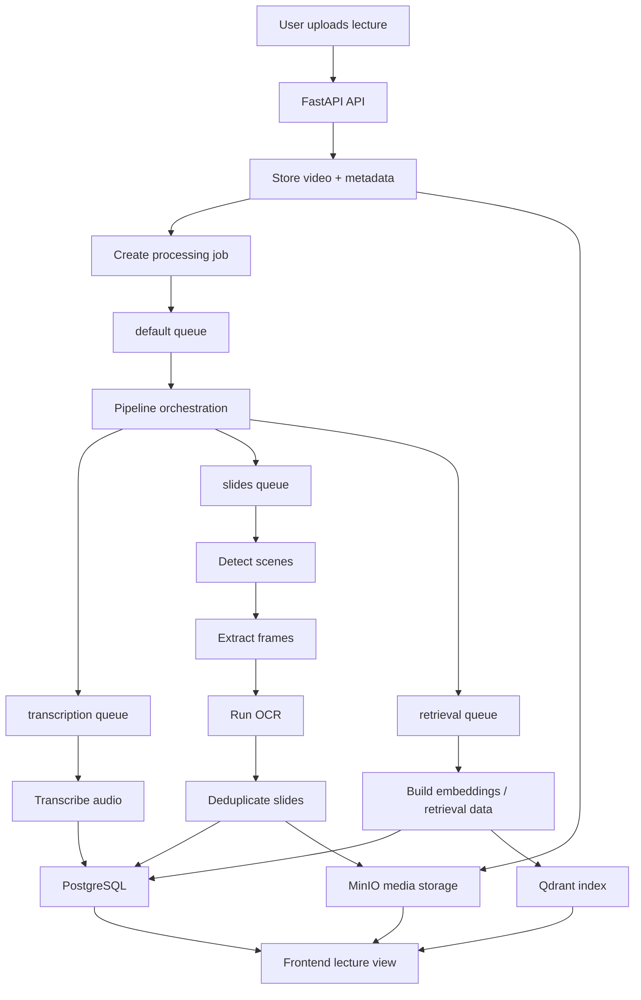

# Architecture

## Overview

Seekr uses a service-oriented architecture built around a web frontend, a FastAPI backend, and multiple Celery workers for asynchronous processing.

## System Layers

| Layer | Responsibility |
| --- | --- |
| Frontend | Upload lectures, browse processed content, ask questions, and review notes and slides |
| API | Validate requests, manage authentication, create jobs, and return structured responses |
| Workers | Run long-lived tasks such as transcription, slide extraction, and retrieval preparation |
| Storage | Persist metadata, media artifacts, task state, and vector-search data |

## Processing Flow

## Reading The Flow

1. The API accepts the upload and stores the original lecture plus initial metadata.
2. A background job is created so the request can return quickly.
3. The default queue orchestrates downstream work and fans out into specialised queues.
4. Transcription, slide extraction, and retrieval preparation run asynchronously.
5. Results are written back to the database, media storage, and vector index for the frontend to consume.

The slides path is isolated in its own worker because scene detection, frame extraction, and OCR are the most CPU- and memory-intensive parts of the pipeline.

## Queue Responsibilities

| Queue | Responsibility |
| --- | --- |
| `default` | pipeline orchestration and general coordination |
| `transcription` | audio transcription tasks |
| `slides` | scene detection, frame extraction, OCR, and slide deduplication |
| `retrieval` | embeddings, ranking data, and retrieval preparation |

## Storage Responsibilities

| Service | Responsibility |
| --- | --- |
| PostgreSQL | relational metadata, lecture state, notes, and structured outputs |
| MinIO | uploaded videos, audio artifacts, thumbnails, and slide exports |
| Qdrant | vector index for semantic retrieval |
| Redis | task result storage and lightweight caching |
| RabbitMQ | queue transport for Celery workers |

## Design Notes

- Long-running tasks are handled asynchronously so uploads and API responses stay responsive.
- Media artifacts are kept separate from relational metadata.
- Search and Q&A depend on structured transcript and retrieval outputs.
- Slide extraction has a dedicated worker so OCR-heavy workloads do not block the rest of the system.
